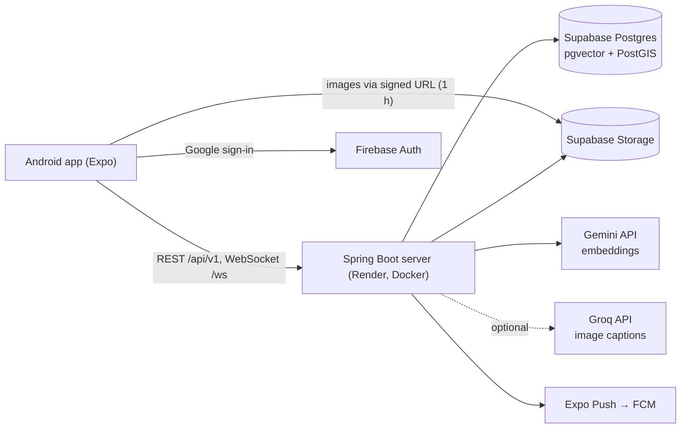

# Refound

**Refound** is a lost-and-found app for a university campus. People post items they found or lost, with photos and a location. The server keeps matching "lost" posts against "found" posts (image and text similarity, distance, time, category) and notifies the owner when a likely match appears. Before anything is handed over, the owner must answer a private verification question set by the finder, and the handover is confirmed by scanning a QR code.

Course project for IE307 (3 weeks, 6 people). Android is the primary platform.

> Most design documents in `docs/` are written in Vietnamese, and all user-facing text in the app is Vietnamese.

## Contents

- [Features](#features)
- [Architecture](#architecture)
- [Tech stack](#tech-stack)
- [Prerequisites](#prerequisites)
- [Getting started: app](#getting-started-app)
- [Getting started: server](#getting-started-server)
- [Environment variables](#environment-variables)
- [Commands](#commands)
- [Project structure](#project-structure)
- [API overview](#api-overview)
- [Testing and CI](#testing-and-ci)
- [Building and deploying](#building-and-deploying)
- [Contributing](#contributing)
- [Documentation](#documentation)

## Features

Scope follows `docs/yeu-cau-nghiep-vu.md`. Current progress for each task is tracked in [`docs/tien-do.md`](docs/tien-do.md).

| Priority | Feature                                                                                                                    |
| -------- | -------------------------------------------------------------------------------------------------------------------------- |
| P0       | Google sign-in, post lost / found items (photos, description, category, location, time), map and list views, ranked search |
| P1       | Background matching with push notifications, owner verification, QR handover, anonymous chat, reputation score, reporting  |
| P2       | Heatmap, printable QR tags for belongings (cut first if time runs short)                                                   |

What makes it more than a bulletin board:

1. **Automatic matching.** Each post is embedded (image and text share one vector space) and scored against open posts of the opposite type:
   `S = 0.5·s_vector + 0.2·s_distance + 0.15·s_time + 0.15·s_category`, each term normalised to [0, 1]. Matches above 0.45 are stored, above 0.65 trigger a push notification. Each match comes with human-readable reasons ("similar photo", "near the same place", "around the same time").
2. **Owner verification.** The finder sets a secret question and answer. The claimant answers it, and the finder decides whether to accept. There is no shortcut around this step.
3. **Privacy.** Contact happens through anonymous chat. Sensitive categories (ID cards, documents) never show public photos. Locations are rounded before being shown to others.

Out of scope: training custom models, payments or rewards, iOS and web builds, email/password or phone sign-in, multiple institutions.

## Architecture



Key decisions (full list in [`docs/kien-truc/11-adr.md`](docs/kien-truc/11-adr.md)):

- **The app only talks to the server.** It never calls Supabase directly and holds no keys. The only thing compiled into the APK is the server URL.
- **Auth:** the app signs in with Google through Firebase and sends the Firebase ID token to the server once. The server verifies the signature against Google's public keys and issues its own JWT (valid 7 days). The server never stores emails or passwords; users are identified by `firebase_uid`.
- **Authorization lives on the server** (Spring Security for JWT and admin role, ownership checks in services, viewer-specific DTOs). Every protected endpoint has a cross-access test.
- **State transitions** for items and claims happen only on the server, inside a transaction, guarded by `UPDATE ... WHERE status = :old`.
- **Background jobs** (embedding, matching, expiry) run inside the Spring process with `@Scheduled`. Job state is stored in columns of the `items` table, so a restart or sleep does not lose work.
- **WebSocket only signals** that something changed; the app always re-fetches data over REST. If the socket drops, the app is still correct, just slower.
- **AI degradation:** if Groq fails, items are still embedded without a caption. If Gemini is rate-limited, the job backs off and search falls back to non-vector scoring.
- **Free tier constraints:** Render free sleeps after ~15 minutes idle and has 512 MB RAM, so the first request can be very slow. The app shows a waiting state and retries. A daily GitHub Actions cron touches the database through the health endpoint so the free Supabase project is not paused.

## Tech stack

| Layer             | Technology                                                                                                                |
| ----------------- | ------------------------------------------------------------------------------------------------------------------------- |
| App               | Expo SDK 58, React Native 0.88, React 19, TypeScript 6 (strict)                                                           |
| Navigation        | Expo Router (file-based routes in `src/app/`)                                                                             |
| Styling           | NativeWind 4 (Tailwind 3) via `className`                                                                                 |
| Server data       | TanStack Query (persisted to AsyncStorage)                                                                                |
| Local state       | Zustand                                                                                                                   |
| Forms             | react-hook-form + zod                                                                                                     |
| Maps              | MapLibre React Native with OpenStreetMap tiles                                                                            |
| Backend           | Spring Boot 3, Java 21, Maven (`server/`), REST + STOMP over WebSocket                                                    |
| Database, storage | Supabase Postgres (pgvector, PostGIS) and Storage; schema migrations with Flyway                                          |
| AI                | Gemini `gemini-embedding-2` (768-dim image + text embeddings), Groq `qwen/qwen3.8-27b` (image captions); server-side only |
| Auth              | Firebase Auth (Google only) → server-issued JWT                                                                           |
| Hosting           | Server on Render (Docker), app distributed as APK via EAS                                                                 |
| Tests             | Jest (`jest-expo`) for the app; JUnit 5 + Testcontainers for the server                                                   |

## Prerequisites

- Node.js 22.13+ or 24.3+
- JDK 21 (Maven is bundled as `./mvnw`)
- Docker, for server integration tests (`./mvnw verify`) or a local Postgres
- A physical Android phone (recommended) or the Android Emulator
- An Expo account, to install or create development builds through EAS

## Getting started: app

```bash
git clone https://github.com/ndkxm/Refound.git
cd Refound
npm install
cp .env.example .env   # then set EXPO_PUBLIC_API_URL
npm start
```

The app runs as a **development build**, not in Expo Go, so a build must be installed on the phone before `npm start` is useful.

### Installing the development build on Android

1. Open the EAS build link shared in the team chat (an expo.dev build page) on your phone, or scan the QR code on that page, then tap **Install** to download the APK.
2. Install the APK. If Android asks, allow your browser to install apps from unknown sources.
3. On your computer run `npm start`. The phone and the computer must be on the same Wi-Fi network.
4. Open the installed **Refound** app and pick the running dev server (or scan the QR code in the terminal). Code changes reload automatically.

If you are on different networks, or the Wi-Fi blocks device-to-device traffic (common on campus networks), use a tunnel:

```bash
npx expo start --tunnel
```

You only need a new build when the team adds a native library or changes `app.config.ts`. Editing JS/TS code never requires a rebuild. The build is made with:

```bash
npx eas-cli@latest build --profile development --platform android
```

or locally with `npx expo run:android`.

### Pointing the app at a server

`EXPO_PUBLIC_API_URL` in `.env` is the server address:

- local server and a physical phone: your computer's LAN IP, e.g. `http://192.168.1.20:8080` (`localhost` does not work from the phone);
- Android Emulator: `http://10.0.2.2:8080`;
- shared server: the Render URL.

## Getting started: server

Dashboard setup (Supabase, Firebase, Render, Gemini, Groq) is a one-time job described in [`docs/setup.md`](docs/setup.md). To run the server locally:

```bash
cd server
cp .env.example .env   # fill in the values, never commit this file
./mvnw spring-boot:run
```

Spring reads `server/.env` automatically (`spring.config.import` in `application.yml`). Without it, the server falls back to a local Postgres at `localhost:5432` (user and password `postgres`) with the `refound` schema; that database needs the `vector` and `postgis` extensions.

Check it is up:

```
http://localhost:8080/api/v1/health?db=true
```

The response should contain `"db":"up"`. Flyway applies migrations from `server/src/main/resources/db/migration/` on startup.

## Environment variables

### App (`.env`)

| Variable              | Description                                                                |
| --------------------- | -------------------------------------------------------------------------- |
| `EXPO_PUBLIC_API_URL` | Base URL of the Spring server. This is the only variable the app may have. |

Every `EXPO_PUBLIC_*` value is compiled into the APK and readable by anyone who has the file. **Never** put Supabase keys, AI keys or passwords in the app.

### Server (`server/.env` locally, Render Environment in production)

| Variable                    | Description                                                                                   |
| --------------------------- | --------------------------------------------------------------------------------------------- |
| `DATABASE_URL`              | JDBC URL of the Supabase **session pooler**, with `currentSchema=refound,extensions`          |
| `DATABASE_USERNAME`         | `postgres.<project-ref>`                                                                      |
| `DATABASE_PASSWORD`         | Database password                                                                             |
| `SUPABASE_URL`              | `https://<project-ref>.supabase.co`                                                           |
| `SUPABASE_SERVICE_ROLE_KEY` | Supabase secret key, server only                                                              |
| `SUPABASE_STORAGE_BUCKET`   | Private image bucket, default `item-images`                                                   |
| `FIREBASE_PROJECT_ID`       | Firebase project ID, used to check `iss` / `aud` of ID tokens (not secret)                    |
| `JWT_SECRET`                | Random string of at least 32 bytes; use different values locally and on Render                |
| `JWT_EXPIRATION_MS`         | Token lifetime, default `604800000` (7 days)                                                  |
| `GEMINI_API_KEY`            | Google AI Studio key                                                                          |
| `GEMINI_EMBEDDING_MODEL`    | Default `gemini-embedding-2`. Changing the model requires re-embedding every item             |
| `GROQ_API_KEY`              | Groq key. Leave empty to disable image captions                                               |
| `GROQ_VISION_MODEL`         | Default `qwen/qwen3.8-27b` (a preview model on Groq, kept configurable in case it is removed) |
| `SPRING_PROFILES_ACTIVE`    | `prod` on Render                                                                              |
| `PORT`                      | HTTP port, default `8080` (set by Render)                                                     |

## Commands

### App (repository root)

| Command                      | What it does                                                 |
| ---------------------------- | ------------------------------------------------------------ |
| `npm start`                  | Start the Expo dev server                                    |
| `npm run android`            | Build and run a local development build (`expo run:android`) |
| `npm run lint`               | ESLint                                                       |
| `npm run typecheck`          | TypeScript type check                                        |
| `npm test`                   | Jest                                                         |
| `npm run check`              | Lint + typecheck + tests. **Required before opening a PR**   |
| `npm run format`             | Format with Prettier                                         |
| `npx expo install <package>` | Install a library at the version matching Expo SDK 58        |
| `npx expo-doctor`            | Check config and dependency versions                         |

### Server (`server/`)

| Command                  | What it does                                                                                                                 |
| ------------------------ | ---------------------------------------------------------------------------------------------------------------------------- |
| `./mvnw spring-boot:run` | Run the server locally                                                                                                       |
| `./mvnw test`            | Unit tests only (no Docker needed)                                                                                           |
| `./mvnw verify`          | Unit + integration + cross-access tests with Testcontainers (needs Docker). **Required before a PR that touches the server** |

On Windows use `mvnw.cmd` instead of `./mvnw`.

## Project structure

```
src/
├── app/                # Screens (Expo Router): one file per route, UI composition only
├── features/           # One folder per feature, each split into api/ hooks/ components/ utils/
│   ├── auth/           # Google sign-in, display name, profile
│   ├── items/          # Post lost/found items, map, list, detail
│   ├── matching/       # Search, possible matches, proactive match alerts (display only)
│   ├── claims/         # Owner verification, QR handover, anonymous chat
│   └── notifications/  # Push, inbox, notification settings
├── components/ui/      # Shared design system components
├── lib/                # API client, query client, WebSocket client
├── stores/             # Zustand stores
├── types/              # Types matching the server API contract
└── global.css          # Tailwind (NativeWind)

server/
├── Dockerfile
└── src/main/java/com/refound/
    ├── auth/           # Firebase token verification, JWT, users, profile
    ├── item/           # Items, categories, item state machine, location rounding
    ├── matching/       # Embedding job, match scoring, search
    ├── claim/          # Claim state machine, verification attempts, handover codes
    └── common/         # Security config, errors, storage client, health check
    # each module: presentation / application / domain / infrastructure
└── src/main/resources/db/migration/   # Flyway migrations (add new files only)

docs/                   # Requirements, architecture, setup, progress (Vietnamese)
.github/workflows/      # CI and the daily health-check cron
```

Use the `@/` import alias for anything under `src/`, e.g. `import { cn } from '@/utils/cn'`. File names are kebab-case (`item-card.tsx`, `use-match-score.ts`).

## API overview

All endpoints live under `/api/v1` and, except health and sign-in, require `Authorization: Bearer <server JWT>`. The full contract, error codes and WebSocket topics are in [`docs/kien-truc/06-api.md`](docs/kien-truc/06-api.md).

| Method   | Path                     | Purpose                                                |
| -------- | ------------------------ | ------------------------------------------------------ |
| `GET`    | `/health`                | Liveness; `?db=true` also checks the database          |
| `POST`   | `/auth/firebase`         | Exchange a Firebase ID token for a server JWT          |
| `GET`    | `/me`                    | Current user profile                                   |
| `PUT`    | `/me/avatar`             | Upload avatar (multipart)                              |
| `GET`    | `/me/items`              | Items posted by the current user                       |
| `GET`    | `/users/{id}`            | Public profile of another user                         |
| `GET`    | `/categories`            | Item categories                                        |
| `GET`    | `/items`                 | List / map query of public items                       |
| `POST`   | `/items`                 | Create an item (multipart, JPEG ≤ 1 MB per image)      |
| `GET`    | `/items/{id}`            | Item detail (fields depend on who is viewing)          |
| `PATCH`  | `/items/{id}`            | Edit an item                                           |
| `DELETE` | `/items/{id}`            | Delete an item                                         |
| `GET`    | `/items/{id}/secret`     | Verification question and answer (finder only)         |
| `POST`   | `/items/{id}/close`      | Close an item                                          |
| `POST`   | `/items/{id}/mark-found` | Mark a lost item as found                              |
| `POST`   | `/items/{id}/renew`      | Extend an item before it expires                       |
| `POST`   | `/search`                | Ranked search by text and/or photo, with match reasons |

Claims, chat and notification endpoints are being built; see `docs/tien-do.md`.

## Testing and CI

- **Pure logic must have unit tests.** On the server: match scoring, item and claim state machines, access checks (`*Access`), location rounding. In the app: distance/time formatting and form schemas, with tests next to the file (`format-distance.ts` → `format-distance.test.ts`).
- For formulas and algorithms, work out an example by hand first and use it as the expected value in the test.
- Every endpoint with access control has a **cross-access test**: user A requesting user B's data must be rejected.
- Integration tests (`*IT`) run against a real Postgres with pgvector/PostGIS through Testcontainers.

GitHub Actions ([`.github/workflows/ci.yml`](.github/workflows/ci.yml)) runs `npm run check` and `./mvnw verify` on every pull request and on pushes to `main`. A second workflow ([`health-cron.yml`](.github/workflows/health-cron.yml)) calls the health endpoint once a day so the free Supabase project is not paused for inactivity.

## Building and deploying

**Server.** Render builds `server/Dockerfile` as a Docker web service from the `server/` directory. Set the environment variables listed above in Render's Environment tab and use `/api/v1/health` as the health check path. The server is tuned for 512 MB of RAM (small thread and connection pools).

**App.** EAS build profiles in [`eas.json`](eas.json):

| Profile       | Output                                       |
| ------------- | -------------------------------------------- |
| `development` | Development client for daily work (internal) |
| `preview`     | Installable APK for testing (internal)       |
| `production`  | Release APK, version code auto-incremented   |

```bash
npx eas-cli@latest build --profile preview --platform android
```

Google sign-in needs `google-services.json` (from Firebase, with the SHA-1/SHA-256 of the signing key registered). Keep it in the repo root for local builds and in the EAS file environment variable `GOOGLE_SERVICES_JSON` for cloud builds. It is not committed. Set `EXPO_PUBLIC_API_URL` to the Render URL for real builds.

## Contributing

Read [`AGENTS.md`](AGENTS.md) before writing code; it holds all team conventions and applies to AI tools as well. The short version:

- **Pick work from [`docs/tien-do.md`](docs/tien-do.md).** Take a ⬜ task whose prerequisites are ✅ and whose main files don't overlap a task in progress (🔵). Claiming a task is the one change pushed straight to `main` (`docs(tien-do): nhận <task id>`).
- **Branches:** `feature/<short-name>` from `main`, merged back through a PR with at least one approval. Keep PRs small (under ~400 lines) and to one task.
- **Commits:** Conventional Commits with the task ID, e.g. `feat(matching): embedding service (P0-10)`.
- **Before a PR:** `npm run check` passes; `./mvnw verify` passes if the server changed; new screens include a screenshot from an Android device.
- **Database:** every schema change is a new Flyway migration. Never edit a migration that has been merged into `main`. Any PR with SQL needs a second person to read it closely.
- **Dependencies:** ask the team before adding any library. Native libraries force everyone to reinstall the development build. Report `pom.xml` additions too.
- **UI:** use `className` and the tokens in `tailwind.config.js` (no hard-coded colours), reuse `src/components/ui/`, and give every screen loading, error (with retry) and empty states. User-facing text is Vietnamese with diacritics.
- **Dates and places:** store `timestamptz`, display in `Asia/Ho_Chi_Minh`; store locations as `geography(Point, 4326)`, distances in metres.
- **Secrets:** never commit `.env`, `server/.env`, `google-services.json` or any key. Don't paste secrets into AI chats.

A task is done when it runs on a real Android device, has loading/error/empty states (for screens), has unit tests for its logic, passes the checks, is merged, the author can explain the code, and its status is ✅ in `docs/tien-do.md`.

## Documentation

| Document                                                 | Contents                                                                                                                                        |
| -------------------------------------------------------- | ----------------------------------------------------------------------------------------------------------------------------------------------- |
| [`docs/yeu-cau-nghiep-vu.md`](docs/yeu-cau-nghiep-vu.md) | Business requirements, rules, item and claim lifecycles                                                                                         |
| [`docs/ke-hoach.md`](docs/ke-hoach.md)                   | Project outline                                                                                                                                 |
| [`docs/tien-do.md`](docs/tien-do.md)                     | Task board, progress, per-task notes, changelog                                                                                                 |
| [`docs/setup.md`](docs/setup.md)                         | One-time setup of Supabase, Render, Firebase, Gemini, Groq, EAS                                                                                 |
| [`docs/kien-truc/`](docs/kien-truc/README.md)            | Architecture: components, data model, permissions, matching, state machines, API, fault tolerance, code layout, testing, ADRs, open assumptions |
