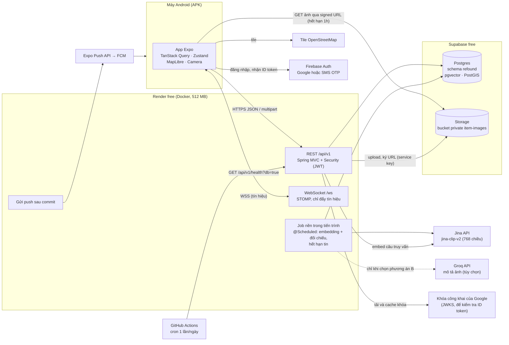
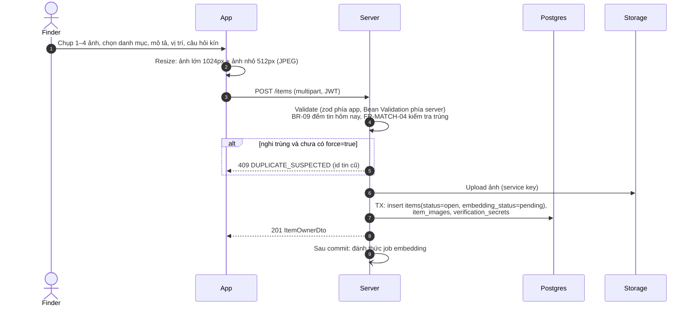
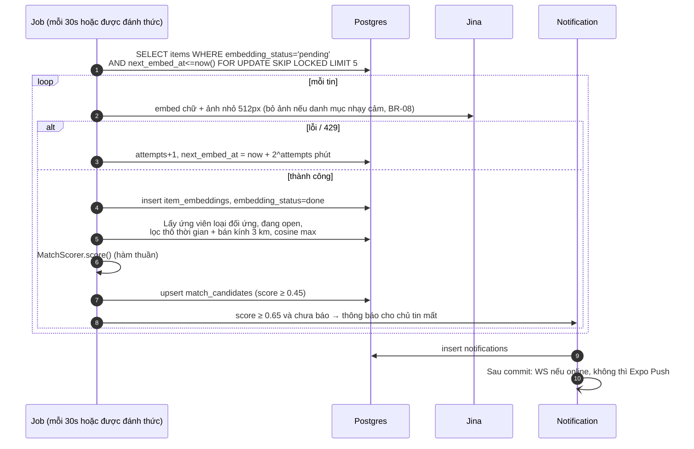

# 1. Kiến trúc tổng thể

Một app Android, một server Spring Boot (một instance trên Render free), một Postgres + Storage của Supabase. Mọi logic nghiệp vụ, khóa bí mật và lời gọi AI nằm ở server. App chỉ biết `EXPO_PUBLIC_API_URL`.

## Sơ đồ thành phần



Ghi chú:

- Đăng nhập: app đăng nhập Firebase bằng Google hoặc OTP, gửi ID token cho server một lần; server kiểm tra chữ ký bằng khóa công khai của Google rồi phát hành JWT riêng. Sau đó app chỉ dùng JWT của server (ADR-05).
- App **không** giữ khóa Supabase. Ảnh tải bằng signed URL do server cấp; URL không chứa khóa và hết hạn sau 1 giờ (ADR-06).
- WebSocket chỉ báo "có gì đó thay đổi"; dữ liệu thật luôn lấy lại qua REST. Mất WS thì app vẫn đúng, chỉ chậm hơn (ADR-07).
- Job nền chạy trong chính tiến trình Spring, trạng thái job lưu trong cột của bảng `items`, nên server ngủ hay khởi động lại không mất việc (ADR-01).

## Các lớp trong server

| Lớp              | Nội dung                                                                   | Ví dụ                                             |
| ---------------- | -------------------------------------------------------------------------- | ------------------------------------------------- |
| `presentation`   | Controller REST, DTO theo người xem, STOMP config                          | `ItemController`, `ItemPublicDto`                 |
| `application`    | Service, transaction, gọi policy và state machine, phát sự kiện            | `ClaimService.accept()`                           |
| `domain`         | Hàm thuần, không Spring, không DB: chấm điểm, máy trạng thái, policy quyền | `MatchScorer`, `ClaimStateMachine`, `ClaimAccess` |
| `infrastructure` | JDBC/JPA repository, client Jina/Groq/Storage/Expo Push                    | `JinaEmbeddingClient`                             |

Phần khó (đối chiếu, máy trạng thái, phân quyền) nằm ở `domain` dưới dạng hàm thuần, test bằng JUnit không cần DB. Đây là phần mỗi thành viên phải giải thích được khi bảo vệ.

## Luồng 1: đăng tin (nhặt được)



Đăng tin không chờ AI (NFR-05): nếu Jina lỗi, tin vẫn được lưu, job thử lại sau.

## Luồng 2: đối chiếu nền



## Luồng 3: xác minh và bàn giao

```mermaid
sequenceDiagram
  autonumber
  actor O as Owner
  actor F as Finder
  participant S as Server
  O->>S: POST /items/{foundId}/claims {answer}
  S->>S: ClaimAccess + giới hạn thử (BR-05) → claim=submitted
  S-->>F: Thông báo "Có yêu cầu nhận"
  F->>S: GET /claims/{id} (thấy câu trả lời + đáp án của mình)
  F->>S: POST /claims/{id}/accept
  S->>S: TX: claim=accepted, item=claimed
  S-->>O: Thông báo "Được chấp nhận"; mở chat, lộ vị trí chính xác
  O->>S: POST /claims/{id}/messages (chat hẹn gặp)
  Note over O,F: Gặp mặt
  F->>S: POST /claims/{id}/handover-code
  S-->>F: mã 1 lần, hết hạn 10 phút → hiện QR
  O->>S: Quét QR → POST /claims/{id}/handover {code}
  S->>S: TX: kiểm tra hash, hạn, người quét = claimant<br/>claim=completed, item found + lost liên kết = returned,<br/>Finder +10 uy tín, các claim khác của tin → rejected
  S-->>O: Hoàn tất
  S-->>F: Hoàn tất
```
