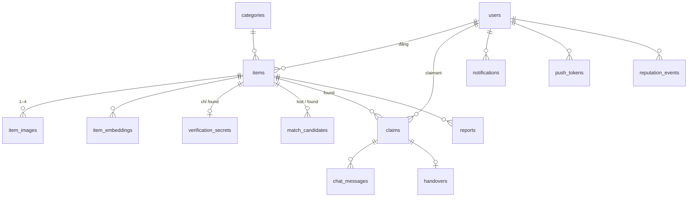

# 2. Lược đồ dữ liệu

- Mọi bảng nằm trong schema riêng `refound`, **không** phải `public`, để Data API (PostgREST) của Supabase không lộ bảng (ADR-10).
- Extension `vector` và `postgis` cài vào schema `extensions` (mặc định của Supabase). Kết nối JDBC đặt `currentSchema=refound,extensions` để gọi kiểu `vector`, `geography` không cần tiền tố _(giả định, kiểm tra ở `12-dieu-chua-chac.md` U7)_.
- Khóa chính `uuid` cho thực thể lộ ra API (không đoán được id), `bigint identity` cho bảng nội bộ lớn dần (tin nhắn, thông báo).
- Thời điểm: `timestamptz`. Vị trí: `geography(Point, 4326)`, khoảng cách tính bằng mét.
- Trạng thái dùng `text` + `CHECK`, không dùng enum của Postgres (thêm giá trị bằng migration mới dễ hơn).
- Không có cột `org_id` (NFR-12): khi cần nhiều trường thì thêm cột `org_id` có mặc định bằng một migration mới. Chưa trả chi phí cho thứ chưa làm.

## 2.1 Sơ đồ quan hệ



## 2.2 Bảng

**P0** (migration mẫu ở 2.4): `categories`, `users`, `items`, `item_images`, `item_embeddings`, `embedding_cache`, `verification_secrets`.
**P1** (migration riêng, người làm module viết): `match_candidates`, `claims`, `handovers`, `chat_messages`, `notifications`, `push_tokens`, `reports`, `reputation_events`.

| Bảng                   | Cột chính                                                                                                                                                                                                                                                                                                                                                                                               | Khóa, ràng buộc, chỉ mục                                                                                                                                                                                          |
| ---------------------- | ------------------------------------------------------------------------------------------------------------------------------------------------------------------------------------------------------------------------------------------------------------------------------------------------------------------------------------------------------------------------------------------------------- | ----------------------------------------------------------------------------------------------------------------------------------------------------------------------------------------------------------------- |
| `categories`           | `code text`, `name_vi`, `group_code`, `sensitive bool`                                                                                                                                                                                                                                                                                                                                                  | PK `code`. Dữ liệu cố định nạp trong migration. `group_code` dùng cho điểm danh mục gần giống                                                                                                                     |
| `users`                | `id uuid`, `firebase_uid`, `display_name`, `avatar_path`, `role` (`user`/`admin`), `status` (`active`/`locked`/`deleted`), `reputation int`, `notification_prefs jsonb`, `terms_version smallint` + `terms_accepted_at` (R04, 03 §3.5), `created_at`                                                                                                                                                    | Unique `firebase_uid`. **Không lưu email, mật khẩu** (ADR-05): định danh là `firebase_uid`, nên server không có gì để lộ (BR-04). `reputation` là tổng cache của `reputation_events`, cập nhật cùng transaction   |
| `items`                | `id uuid`, `author_id`, `type` (`lost`/`found`), `status`, `category`, `description`, `ai_caption` (mô tả ảnh do Groq sinh, chỉ để embed, không trả về app), `happened_at`, `location geography`, `public_location geography`, `radius_m`, `embedding_status`, `embedding_attempts`, `next_embed_at`, `last_activity_at`, `expiry_warned_at`, `closed_reason`, `created_at`, `updated_at`, `deleted_at` | GIST(`location`); btree(`type`,`status`,`happened_at`); partial (`next_embed_at`) WHERE `embedding_status='pending'`. CHECK: `lost` có `radius_m` 50–2000, `found` không                                          |
| `item_images`          | `id uuid`, `item_id`, `position` 0–3, `full_path`, `thumb_path`                                                                                                                                                                                                                                                                                                                                         | Unique(`item_id`,`position`), ON DELETE CASCADE                                                                                                                                                                   |
| `item_embeddings`      | `id bigint`, `item_id`, `source` (`text`/`image`), `image_id` null, `model`, `embedding vector(768)`                                                                                                                                                                                                                                                                                                    | Index(`item_id`). **Không** có index ANN (ADR-03)                                                                                                                                                                 |
| `embedding_cache`      | `key text` = sha256(model‖input), `embedding vector(768)`, `created_at`                                                                                                                                                                                                                                                                                                                                 | PK `key`. Cache câu truy vấn tìm kiếm (giảm gọi Gemini, giúp demo lặp lại)                                                                                                                                        |
| `verification_secrets` | `item_id`, `question`, `answer`                                                                                                                                                                                                                                                                                                                                                                         | PK = FK `item_id`. Bảng tách riêng để không bao giờ bị `SELECT *` kéo theo cùng `items`                                                                                                                           |
| `user_blocks` (R03)    | `blocker_id`, `blocked_id`, `created_at`                                                                                                                                                                                                                                                                                                                                                                | PK(`blocker_id`,`blocked_id`); index(`blocked_id`,`blocker_id`) cho chiều ngược; CHECK không tự chặn. Hiệu lực hai chiều (03 §3.5, BR-15)                                                                         |
| `match_candidates`     | `id uuid`, `lost_item_id`, `found_item_id`, `score real`, `components jsonb` (`{v,d,t,c}`), `source` (`auto`/`finder_report`), `status` (`active`/`dismissed`), `notified_at`, `created_at`                                                                                                                                                                                                             | Unique(`lost_item_id`,`found_item_id`) → upsert                                                                                                                                                                   |
| `claims`               | `id uuid`, `found_item_id`, `lost_item_id` null, `claimant_id`, `finder_id`, `status`, `answer`, `reject_reason`, `cancel_reason`, `created_at`, `updated_at`                                                                                                                                                                                                                                           | Partial unique(`found_item_id`,`claimant_id`) WHERE `status IN ('submitted','accepted')`; partial unique(`found_item_id`) WHERE `status='accepted'`. `finder_id` sao chép từ tin để kiểm tra quyền không cần join |
| `handovers`            | `claim_id`, `code_hash`, `code_expires_at`, `method` (`qr`/`manual`), `note`, `completed_at`                                                                                                                                                                                                                                                                                                            | PK = FK `claim_id`                                                                                                                                                                                                |
| `chat_messages`        | `id bigint`, `claim_id`, `sender_id`, `body` ≤ 1000 ký tự, `created_at`                                                                                                                                                                                                                                                                                                                                 | Index(`claim_id`,`id`) để phân trang `after=id`                                                                                                                                                                   |
| `notifications`        | `id bigint`, `user_id`, `type`, `payload jsonb` (tham số điều hướng), `read_at`, `created_at`                                                                                                                                                                                                                                                                                                           | Index(`user_id`,`created_at desc`)                                                                                                                                                                                |
| `push_tokens`          | `token text`, `user_id`, `updated_at`                                                                                                                                                                                                                                                                                                                                                                   | PK `token` (một máy đổi người dùng thì token chuyển chủ)                                                                                                                                                          |
| `reports`              | `id uuid`, `item_id` null, `claim_id` null, `reporter_id`, `reason`, `status` (`open`/`valid`/`invalid`), `created_at`                                                                                                                                                                                                                                                                                  | Unique(`item_id`,`reporter_id`)                                                                                                                                                                                   |
| `reputation_events`    | `id bigint`, `user_id`, `delta`, `reason`, `claim_id` null, `created_at`                                                                                                                                                                                                                                                                                                                                | Index(`user_id`)                                                                                                                                                                                                  |
| `tags` _(P2)_          | `id uuid`, `owner_id`, `label`, `code` (ngẫu nhiên, in vào QR), `created_at`                                                                                                                                                                                                                                                                                                                            | Unique `code`                                                                                                                                                                                                     |

## 2.3 Vị trí công khai (BR-11, BR-13)

`public_location` tính một lần khi ghi, trong `domain/LocationRounding` (hàm thuần, có test):

- Tin `found`: làm tròn vĩ độ, kinh độ tới 3 chữ số thập phân (ô khoảng 110 m × 110 m ở vĩ độ TP.HCM) ≈ mức tòa nhà.
- Tin `lost`: tâm khu vực + `radius_m` do người dùng chọn; đây vốn đã là khu vực, công khai nguyên giá trị.

Ví dụ tính tay cho test: `(10.870345, 106.803128)` → `(10.870, 106.803)`; `(10.8705, 106.8035)` → `(10.871, 106.804)` (làm tròn nửa lên, `RoundingMode.HALF_UP`).

Ước lượng dung lượng (NFR-13: vài trăm tin): 300 tin × 3 vector × 768 × 4 byte ≈ 2,8 MB. DB không phải nút thắt.

## 2.4 Migration mẫu cho P0

File dự kiến: `server/src/main/resources/db/migration/V202611230900__core_p0.sql` (quy ước đặt tên ở ADR-13). Chưa tạo file vì nhiệm vụ này chỉ viết tài liệu.

```sql
-- Extension: Supabase đặt ở schema extensions
create extension if not exists vector  with schema extensions;
create extension if not exists postgis with schema extensions;

create schema if not exists refound;
set search_path = refound, extensions;

create table categories (
  code       text primary key,
  name_vi    text not null,
  group_code text not null,
  sensitive  boolean not null default false
);

insert into categories (code, name_vi, group_code, sensitive) values
  ('student_card', 'Thẻ sinh viên',      'documents',   true),
  ('id_card',      'CCCD / hộ chiếu',    'documents',   true),
  ('bank_card',    'Thẻ ngân hàng',      'documents',   true),
  ('wallet',       'Ví',                  'wallet_bag',  false),
  ('bag',          'Balo, túi',           'wallet_bag',  false),
  ('keys',         'Chìa khóa',           'keys',        false),
  ('phone',        'Điện thoại',          'electronics', false),
  ('earphones',    'Tai nghe',            'electronics', false),
  ('laptop',       'Laptop, máy tính bảng','electronics', false),
  ('charger',      'Sạc, cáp',            'electronics', false),
  ('clothing',     'Áo, mũ',              'clothing',    false),
  ('bottle',       'Bình nước',           'other',       false),
  ('book',         'Sách, vở',            'other',       false),
  ('other',        'Khác',                'other',       false);

create table users (
  id                 uuid primary key default gen_random_uuid(),
  firebase_uid       text not null unique,  -- 'sub' trong Firebase ID token
  display_name       text not null check (char_length(display_name) between 2 and 40),
  avatar_path        text,
  role               text not null default 'user'   check (role in ('user','admin')),
  status             text not null default 'active' check (status in ('active','locked','deleted')),
  reputation         integer not null default 0,
  notification_prefs jsonb not null default '{}'::jsonb,
  created_at         timestamptz not null default now()
);

create table items (
  id                 uuid primary key default gen_random_uuid(),
  author_id          uuid not null references users(id),
  type               text not null check (type in ('lost','found')),
  status             text not null default 'open'
                     check (status in ('open','claimed','returned','closed','expired','under_review')),
  category           text not null references categories(code),
  description        text not null check (char_length(description) between 5 and 1000),
  ai_caption         text,  -- mô tả ảnh do Groq sinh (ADR-02), không trả về app
  happened_at        timestamptz not null,
  location           geography(Point, 4326) not null,
  public_location    geography(Point, 4326) not null,
  radius_m           integer,
  embedding_status   text not null default 'pending'
                     check (embedding_status in ('pending','done','failed')),
  embedding_attempts smallint not null default 0,
  next_embed_at      timestamptz not null default now(),
  last_activity_at   timestamptz not null default now(),
  expiry_warned_at   timestamptz,
  closed_reason      text,
  created_at         timestamptz not null default now(),
  updated_at         timestamptz not null default now(),
  deleted_at         timestamptz,
  constraint items_radius_ck check (
    (type = 'lost'  and radius_m is not null and radius_m between 50 and 2000) or
    (type = 'found' and radius_m is null)),
  constraint items_claimed_found_ck check (status <> 'claimed' or type = 'found'),          -- 5.1 I3
  constraint items_closed_reason_ck check (status <> 'closed' or closed_reason is not null)  -- 5.1 I7, I12
);
create index items_location_gix  on items using gist (location);
create index items_listing_ix    on items (type, status, happened_at desc) where deleted_at is null;
create index items_embed_todo_ix on items (next_embed_at) where embedding_status = 'pending';
create index items_author_ix     on items (author_id, created_at desc);

create table item_images (
  id         uuid primary key default gen_random_uuid(),
  item_id    uuid not null references items(id) on delete cascade,
  position   smallint not null check (position between 0 and 3),
  full_path  text not null,
  thumb_path text not null,
  created_at timestamptz not null default now(),
  unique (item_id, position)
);

create table item_embeddings (
  id         bigint generated always as identity primary key,
  item_id    uuid not null references items(id) on delete cascade,
  source     text not null check (source in ('text','image')),
  image_id   uuid references item_images(id) on delete cascade,
  model      text not null,
  embedding  vector(768) not null,
  created_at timestamptz not null default now(),
  check ((source = 'image') = (image_id is not null)),
  -- job chạy lại không tạo vector trùng; nulls not distinct để chữ (image_id null) cũng chỉ có một
  unique nulls not distinct (item_id, source, image_id)
);
create index item_embeddings_item_ix on item_embeddings (item_id);
-- Không tạo HNSW: vài trăm tin thì quét tuần tự cho kết quả chính xác và vẫn < 50 ms (ADR-03).

create table embedding_cache (
  key        text primary key,
  embedding  vector(768) not null,
  created_at timestamptz not null default now()
);

create table verification_secrets (
  item_id  uuid primary key references items(id) on delete cascade,
  question text not null check (char_length(question) between 5 and 200),
  answer   text not null check (char_length(answer)   between 1 and 200)
);
```

Các migration P1 theo cùng phong cách; ràng buộc quan trọng nhất của `claims`:

```sql
create unique index claims_one_open_per_user
  on claims (found_item_id, claimant_id) where status in ('submitted','accepted');
create unique index claims_one_accepted_per_item
  on claims (found_item_id) where status = 'accepted';
```
