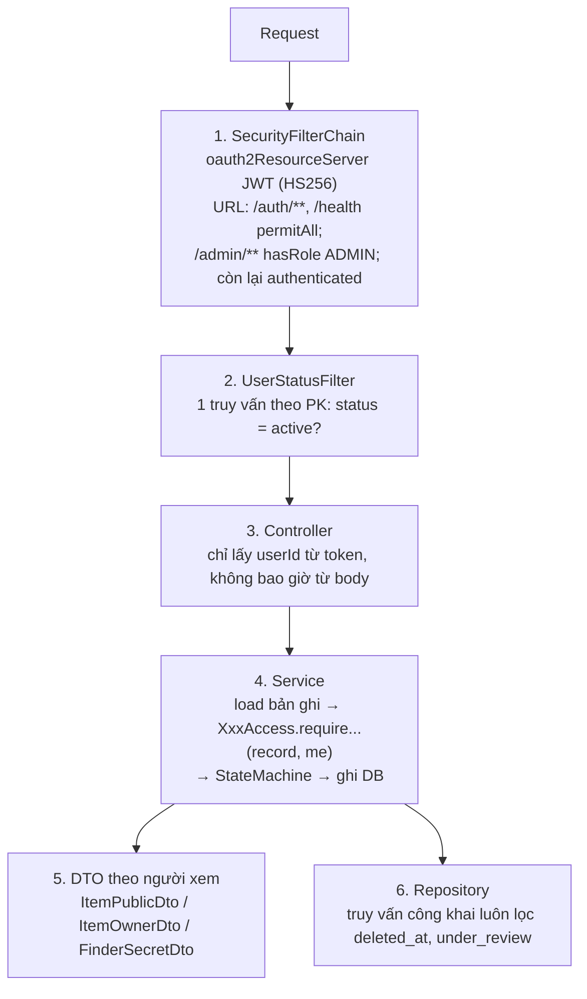

# 3. Ma trận quyền và cách thực thi

Không còn RLS làm lớp thứ hai (server nối DB bằng một role duy nhất), nên phân quyền phải **dễ đọc, nằm một chỗ, có test**.

## 3.1 Vai trò

| Vai trò   | Định nghĩa (tính theo từng bản ghi, trừ Admin)                          |
| --------- | ----------------------------------------------------------------------- |
| Khách     | Chưa đăng nhập. Chỉ gọi được `/auth/*` và `/health`                     |
| Người lạ  | Đã đăng nhập, không liên quan tới bản ghi                               |
| Tác giả   | `items.author_id = me` (Owner của tin `lost`, Finder của tin `found`)   |
| Bên claim | `claims.claimant_id = me` (Owner) hoặc `claims.finder_id = me` (Finder) |
| Admin     | `users.role = 'admin'`                                                  |

Tài khoản `locked` hoặc `deleted` bị từ chối ở filter (401) dù JWT còn hạn.

## 3.2 Ma trận

✅ được · ❌ không · ghi chú = được một phần. Khách bị chặn mọi thứ dưới đây (401), nên không có cột.

| Thực thể           | Thao tác                                   | Người lạ                                                                               | Tác giả tin                               | Bên claim                                                              | Admin                                     |
| ------------------ | ------------------------------------------ | -------------------------------------------------------------------------------------- | ----------------------------------------- | ---------------------------------------------------------------------- | ----------------------------------------- |
| Profile            | Xem                                        | Tên, ảnh, uy tín                                                                       | =                                         | =                                                                      | + cách đăng nhập (Google/SĐT), trạng thái |
| Profile            | Sửa / xóa                                  | Chỉ của mình                                                                           |                                           |                                                                        | Khóa tài khoản                            |
| Item               | Xem danh sách, chi tiết                    | Tin `open`/`claimed`, không `under_review`; tin `found` chỉ có vị trí làm tròn (BR-11) | Mọi trạng thái của mình, vị trí chính xác | Claimant được chấp nhận: vị trí chính xác của tin `found`              | Mọi tin                                   |
| Item               | Tạo                                        | ✅ (BR-09)                                                                             |                                           |                                                                        | ✅                                        |
| Item               | Sửa, đóng, gia hạn, xóa                    | ❌                                                                                     | ✅ (theo bảng 5.1)                        | ❌                                                                     | Chỉ `restore`/`remove`                    |
| ItemImage          | Xem                                        | Tin không nhạy cảm: ✅. Nhạy cảm: ❌ (BR-08, FR-ITEM-07)                               | ✅                                        | Nhạy cảm: chỉ claimant khi claim `accepted` hoặc `completed`           | ✅                                        |
| ItemEmbedding      | Bất kỳ                                     | ❌                                                                                     | ❌                                        | ❌                                                                     | ❌ (chỉ server dùng, không có API)        |
| VerificationSecret | Xem câu hỏi                                | Khi bắt đầu claim (tin `found`, `open`)                                                | ✅                                        | ✅                                                                     | ✅                                        |
| VerificationSecret | Xem đáp án                                 | ❌                                                                                     | Chỉ tác giả tin `found` (BR-02)           | ❌ (kể cả Owner)                                                       | ❌                                        |
| MatchCandidate     | Xem, bỏ qua                                | ❌                                                                                     | Tác giả của một trong hai tin             |                                                                        | ❌                                        |
| MatchCandidate     | Báo khớp (FR-MATCH-06)                     | Từ tin `lost` của người khác, gắn tin `found` **của mình**                             |                                           |                                                                        |                                           |
| Claim              | Tạo                                        | ✅ trên tin `found` không phải của mình (C1)                                           | ❌ trên tin của mình                      |                                                                        | ❌                                        |
| Claim              | Xem                                        | ❌                                                                                     | (Finder là bên claim)                     | ✅ hai bên; câu trả lời của Owner hiện cho cả hai                      | Siêu dữ liệu + lý do, **không** chat      |
| Claim              | Chấp nhận, từ chối, tạo mã QR, tự xác nhận | ❌                                                                                     |                                           | Chỉ Finder                                                             | ❌                                        |
| Claim              | Rút, quét QR                               | ❌                                                                                     |                                           | Chỉ Owner                                                              | ❌                                        |
| Claim              | Hủy, tranh chấp                            | ❌                                                                                     |                                           | Hai bên                                                                | `resolve`                                 |
| ChatMessage        | Đọc, gửi                                   | ❌                                                                                     |                                           | Hai bên, chỉ khi claim `accepted` (đọc được cả sau đó, không gửi được) | ❌                                        |
| Handover           | Xem                                        | ❌                                                                                     |                                           | Hai bên (không bao giờ trả `code_hash`)                                | ✅                                        |
| Notification       | Đọc, đánh dấu                              | Chỉ của mình                                                                           |                                           |                                                                        | ❌                                        |
| PushToken          | Ghi, xóa                                   | Chỉ của mình                                                                           |                                           |                                                                        | ❌                                        |
| Report             | Tạo                                        | ✅ (1 lần/tin/người, không tự báo tin mình)                                            | ❌                                        |                                                                        |                                           |
| Report             | Xem, xử lý                                 | ❌                                                                                     | ❌                                        | ❌                                                                     | ✅                                        |
| ReputationEvent    | Xem                                        | Chỉ của mình                                                                           |                                           |                                                                        | ✅                                        |
| Tag _(P2)_         | Tạo, xem, xóa                              | Chỉ của mình; người quét chỉ gửi được tin nhắn, không thấy danh tính                   |                                           |                                                                        | ❌                                        |

## 3.3 Thực thi ở đâu trong Spring

| Lớp                             | Làm gì                                                                                                            | Vì sao chọn                                                                                         |
| ------------------------------- | ----------------------------------------------------------------------------------------------------------------- | --------------------------------------------------------------------------------------------------- |
| Filter (Spring Security có sẵn) | Xác thực JWT, vai trò admin theo URL                                                                              | Không tự viết filter JWT; dùng `NimbusJwtDecoder.withSecretKey` có sẵn                              |
| `@PreAuthorize`                 | **Chỉ** `hasRole('ADMIN')` trên controller admin (lớp thứ hai sau URL)                                            | Kiểm tra sở hữu bằng SpEL khó đọc và khó test; không dùng cho việc này                              |
| Service + `*Access`             | Mọi kiểm tra sở hữu / tham gia                                                                                    | Hàm thuần `ClaimAccess.requireFinder(claim, me)`, đọc được trong buổi bảo vệ, test không cần Spring |
| DTO                             | Không có DTO nào ngoài `FinderSecretDto` chứa trường `answer` của câu hỏi kín; `code_hash` không có trong DTO nào | Không thể lộ nhầm do quên `@JsonIgnore`                                                             |
| DB                              | Partial unique index, `CHECK`; schema `refound` không mở qua Data API của Supabase (ADR-10)                       | Bất biến giữ được kể cả khi service sai                                                             |

Quy ước trả lỗi: tài nguyên mà người gọi **không được biết là có tồn tại** (claim, chat, đáp án, tin `under_review` hoặc đã xóa) trả `404`, không trả `403`. Hành động không được phép trên tài nguyên công khai (sửa tin người khác) trả `403`.

## 3.4 Test truy cập chéo bắt buộc

Mỗi dòng là một test `@SpringBootTest` + MockMvc với hai user A, B có sẵn (fixture). Người viết endpoint tự viết test của endpoint đó (AGENTS.md). Đặt trong `server/src/test/java/com/refound/<module>/presentation/*AccessTest.java`.

| #   | Endpoint                                                                    | Kịch bản                                                                                        | Kỳ vọng                                                              |
| --- | --------------------------------------------------------------------------- | ----------------------------------------------------------------------------------------------- | -------------------------------------------------------------------- |
| X1  | `PATCH /items/{id}`                                                         | B sửa tin của A                                                                                 | 403                                                                  |
| X2  | `POST /items/{id}/close`, `/renew`, `DELETE /items/{id}`                    | B thao tác tin của A                                                                            | 403                                                                  |
| X3  | `GET /items/{id}`                                                           | B xem tin `found` của A                                                                         | 200, không có `answer`, tọa độ đã làm tròn, không có `exactLocation` |
| X4  | `GET /items/{id}`                                                           | B xem tin `under_review` / đã xóa của A                                                         | 404                                                                  |
| X5  | `GET /items/{id}`                                                           | Tin nhạy cảm của A, B chưa claim                                                                | 200, `images` rỗng                                                   |
| X6  | `GET /items/{id}/secret`                                                    | B (kể cả là claimant được chấp nhận)                                                            | 404                                                                  |
| X7  | `GET /items/{id}/matches`, `POST /matches/{id}/dismiss`                     | B không phải tác giả tin nào trong cặp                                                          | 404                                                                  |
| X8  | `POST /items/{lostId}/found-reports`                                        | B gắn tin `found` của C                                                                         | 403                                                                  |
| X9  | `POST /items/{id}/claims`                                                   | A claim tin của chính A                                                                         | 403                                                                  |
| X10 | `POST /items/{id}/claims` với `lostItemId`                                  | B dùng tin `lost` của C                                                                         | 403                                                                  |
| X11 | `GET /claims/{id}`                                                          | C (không phải hai bên)                                                                          | 404                                                                  |
| X12 | `POST /claims/{id}/accept`, `/reject`, `/handover-code`, `/manual-complete` | Claimant gọi thay Finder                                                                        | 403                                                                  |
| X13 | `POST /claims/{id}/handover`                                                | Finder tự quét; C quét mã đúng                                                                  | 403 / 404                                                            |
| X14 | `GET`, `POST /claims/{id}/messages`                                         | C đọc/gửi                                                                                       | 404                                                                  |
| X15 | `POST /claims/{id}/messages`                                                | Bên claim gửi khi claim `submitted` hoặc `completed`                                            | 409                                                                  |
| X16 | `GET /notifications`, `POST /notifications/{id}/read`                       | B đọc / đánh dấu của A                                                                          | chỉ thấy của mình / 404                                              |
| X17 | `GET /users/{id}`                                                           | B xem A                                                                                         | chỉ có tên, ảnh, uy tín; không có `authProvider`, `firebaseUid`      |
| X18 | `/admin/**`                                                                 | User thường                                                                                     | 403                                                                  |
| X19 | Mọi endpoint                                                                | Tài khoản bị khóa, JWT còn hạn                                                                  | 401                                                                  |
| X23 | `POST /auth/firebase`                                                       | ID token giả ký bằng khóa khác, sai `aud` (project khác), hết hạn, `sign_in_provider=anonymous` | 401                                                                  |
| X20 | WS `CONNECT`                                                                | Không có / sai JWT                                                                              | Từ chối kết nối                                                      |
| X21 | WS                                                                          | B nhận được sự kiện của claim A–C                                                               | Không (kiểm tra `convertAndSendToUser` chỉ gửi cho hai bên)          |
| X22 | `GET /reputation-events?userId=`                                            | B xem lịch sử của A                                                                             | 403                                                                  |
