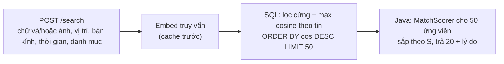

# 4. Thiết kế đối chiếu

Đây là phần "code của nhóm" quan trọng nhất. AI chỉ cung cấp vector; **lọc, chuẩn hóa, kết hợp, ngưỡng và lý do khớp** là của nhóm, nằm trong một hàm thuần `MatchScorer` (server, Java) có JUnit (FR-MATCH-02).

## 4.1 Tạo embedding

| Bước                  | Chi tiết                                                                                                                                                                                                                                                                                                |
| --------------------- | ------------------------------------------------------------------------------------------------------------------------------------------------------------------------------------------------------------------------------------------------------------------------------------------------------- |
| Khi nào               | Tin mới hoặc sửa mô tả/ảnh/danh mục → `embedding_status='pending'`. Job xử lý (mục 4.4)                                                                                                                                                                                                                 |
| Chữ                   | `"title: {tên danh mục} \| text: {mô tả}. {ai_caption}"` (tiền tố tài liệu của `gemini-embedding-2`; bỏ phần `ai_caption` nếu chưa có) → 1 vector `source='text'`                                                                                                                                       |
| Mô tả ảnh             | Trước bước chữ: tối đa 3 ảnh nhỏ 512px → Groq `qwen/qwen3.8-27b` → `items.ai_caption` (một câu tiếng Việt ≤ 40 từ, không hiện cho người dùng). Bỏ qua nếu danh mục `sensitive` hoặc Groq lỗi/429 (ADR-02)                                                                                               |
| Ảnh                   | Mỗi ảnh nhỏ 512px (đã resize ở app) → 1 vector `source='image'`. **Bỏ qua** nếu danh mục `sensitive` (BR-08): tin nhạy cảm chỉ đối chiếu bằng chữ, vị trí, thời gian, danh mục                                                                                                                          |
| Model                 | `gemini-embedding-2`, `output_dimensionality=768` (ảnh và chữ chung không gian vector; vector cắt về 768 được model tự chuẩn hóa). Model này không nhận `task_type`: loại tác vụ ghi trong tiền tố chữ. Ảnh gửi dạng JPEG, tối đa 6 ảnh/request                                                         |
| Câu truy vấn tìm kiếm | `"task: search result \| query: {chữ người dùng gõ}"`, embed đồng bộ khi gọi `/search`; kết quả lưu `embedding_cache` theo sha256(model‖input)                                                                                                                                                          |
| Lỗi                   | Thử lại lùi dần 1, 2, 4, 8, 16, 32 phút; sau 6 lần → `failed` (vẫn hiện trong danh sách, đối chiếu chỉ bằng vị trí/thời gian/danh mục). Gemini trả 429 (hết hạn mức theo phút hoặc ngày) → tạm dừng mọi lời gọi 5 phút (biến trong bộ nhớ). Lỗi của Groq không tính ở đây (bỏ mô tả ảnh, xem dòng trên) |

## 4.2 Công thức điểm khớp

Cho một cặp (tin mất L, tin nhặt F), hoặc (câu truy vấn Q, tin F):

```
S = w_v·s_v + w_d·s_d + w_t·s_t + w_c·s_c          w_v + w_d + w_t + w_c = 1
```

| Thành phần            | Giá trị thô                                                                    | Chuẩn hóa về [0, 1]                            | Thiếu dữ liệu                                                      |
| --------------------- | ------------------------------------------------------------------------------ | ---------------------------------------------- | ------------------------------------------------------------------ |
| `s_v` giống ảnh/mô tả | `cos` = max cosine trên mọi cặp vector (chữ↔chữ, chữ↔ảnh, ảnh↔ảnh) của hai tin | `clamp((cos − c0) / (c1 − c0), 0, 1)`          | 0 (vd. embedding chưa xong)                                        |
| `s_d` khoảng cách     | `d` = `ST_Distance(L.location, F.location)` mét; `r` = `L.radius_m`            | `1` nếu `d ≤ r`, ngược lại `exp(−(d − r) / λ)` | 0 (tìm kiếm không có vị trí: mọi kết quả cùng 0, thứ tự không đổi) |
| `s_t` thời gian       | `Δh` = giờ từ lúc mất tới lúc nhặt                                             | `exp(−max(Δh, 0) / τ)`                         | 0                                                                  |
| `s_c` danh mục        | mã danh mục                                                                    | cùng mã: 1; cùng `group_code`: 0,5; khác: 0    | —                                                                  |

Lọc cứng trước khi chấm (trong SQL): khác loại (BR-01); tin đối ứng `open`, không `under_review`, chưa xóa; `F.happened_at ≥ L.happened_at − 24h` (nhặt trước lúc mất quá 1 ngày là vô lý; cho 1 ngày sai số vì người mất nhớ giờ không chính xác); `ST_DWithin(..., 3000)` (3 km ≈ phạm vi trường).

Tham số khởi đầu _(chỉnh lại sau thử nghiệm 4.6)_:

| Tham số              | Giá trị                   | Ý nghĩa                                                                                       |
| -------------------- | ------------------------- | --------------------------------------------------------------------------------------------- |
| `w_v, w_d, w_t, w_c` | 0,50 · 0,20 · 0,15 · 0,15 | Ảnh/mô tả là tín hiệu mạnh nhất                                                               |
| `c0, c1`             | 0,15 · 0,60               | `c0` ≈ trung vị cosine của cặp **không** khớp, `c1` ≈ phân vị 90 của cặp khớp, đo trên bộ mẫu |
| `λ`                  | 300 m                     | Ra ngoài bán kính 300 m thì `s_d` còn 0,37                                                    |
| `τ`                  | 72 h                      | Nhặt sau 3 ngày thì `s_t` còn 0,37                                                            |
| Ngưỡng lưu ứng viên  | 0,45                      | Lưu `match_candidates` để chủ tin xem                                                         |
| Ngưỡng thông báo     | 0,65                      | Gửi thông báo "có món giống" (một lần mỗi cặp)                                                |

### Ví dụ tính tay (dùng làm đáp án trong `MatchScorerTest`)

**Ví dụ 1, khớp tốt.** L: tai nghe, mất 20/11 09:00, bán kính 200 m. F: tai nghe, nhặt 20/11 15:00, cách tâm 350 m, `cos = 0,48`.

|       | Tính                                                                               | Giá trị                      |
| ----- | ---------------------------------------------------------------------------------- | ---------------------------- |
| `s_v` | (0,48 − 0,15) / 0,45                                                               | 0,7333                       |
| `s_d` | exp(−(350 − 200) / 300) = exp(−0,5)                                                | 0,6065                       |
| `s_t` | exp(−6 / 72) = exp(−0,0833)                                                        | 0,9200                       |
| `s_c` | cùng mã                                                                            | 1                            |
| `S`   | 0,5·0,7333 + 0,2·0,6065 + 0,15·0,9200 + 0,15·1 = 0,3667 + 0,1213 + 0,1380 + 0,1500 | **0,776** → lưu và thông báo |

**Ví dụ 2, không khớp.** F nhặt trước lúc mất 10 giờ (`Δh = −10`, trong sai số), khác nhóm danh mục, `d = 1500`, `r = 300`, `cos = 0,30`.

|       | Tính                         | Giá trị               |
| ----- | ---------------------------- | --------------------- |
| `s_v` | (0,30 − 0,15) / 0,45         | 0,3333                |
| `s_d` | exp(−1200 / 300) = exp(−4)   | 0,0183                |
| `s_t` | exp(−max(−10, 0) / 72)       | 1                     |
| `s_c` | khác nhóm                    | 0                     |
| `S`   | 0,1667 + 0,0037 + 0,1500 + 0 | **0,320** → không lưu |

Test thêm biên: `cos ≤ c0` → `s_v = 0`; `cos ≥ c1` → `s_v = 1`; `d = r` → `s_d = 1`; `Δh = 0` → `s_t = 1`; tổng trọng số khác 1 → lỗi cấu hình khi khởi động.

### Lý do khớp (FR-MATCH-01)

`MatchReasons.of(components, raw)` (hàm thuần) sinh chuỗi tiếng Việt cho thành phần nổi bật:

| Điều kiện                 | Lý do                                                  |
| ------------------------- | ------------------------------------------------------ |
| `s_v ≥ 0,7`               | "Ảnh/mô tả rất giống"                                  |
| `s_d = 1` / `s_d ≥ 0,5`   | "Trong khu vực bạn mất" / "Cách khu vực mất {d − r} m" |
| `s_t ≥ 0,7`               | "Nhặt {Δh} giờ sau khi mất"                            |
| `s_c = 1`                 | "Cùng danh mục"                                        |
| `embedding_status ≠ done` | "Đang xử lý ảnh, điểm có thể chưa chính xác"           |

## 4.3 Tìm kiếm (FR-MATCH-01)



```sql
-- :q là vector câu truy vấn (một hoặc hai vector nếu có cả chữ và ảnh)
select f.id,
       max(1 - (e.embedding <=> :q)) as cos,
       st_distance(f.location, st_makepoint(:lng, :lat)::geography) as dist_m,
       f.happened_at, f.category
from items f
left join item_embeddings e on e.item_id = f.id
where f.type = :type and f.status = 'open' and f.deleted_at is null
group by f.id
order by cos desc nulls last
limit 50;
```

Gemini lỗi khi tìm kiếm → bỏ `s_v`, xếp theo vị trí/thời gian/danh mục + lọc chữ `description ILIKE '%từ khóa%'`, trả cờ `degraded=true` để app hiện "Tìm kiếm ảnh tạm thời không khả dụng".

## 4.4 Đối chiếu nền (FR-MATCH-03)

Chạy **trong tiến trình Spring**, không thêm hàng đợi ngoài (ADR-01):

|           |                                                                                                                                                                                            |
| --------- | ------------------------------------------------------------------------------------------------------------------------------------------------------------------------------------------ |
| Kích hoạt | (1) `@TransactionalEventListener(AFTER_COMMIT)` sau khi tạo/sửa tin → chạy ngay trên executor 1 luồng; (2) `@Scheduled(fixedDelay = 30s)` vét những gì còn sót (server khởi động lại, lỗi) |
| Lấy việc  | `SELECT ... FROM items WHERE embedding_status='pending' AND next_embed_at <= now() ORDER BY next_embed_at LIMIT 5 FOR UPDATE SKIP LOCKED`                                                  |
| Đối chiếu | Sau khi embed tin X: lấy tin đối ứng bằng SQL như 4.3 nhưng cosine là max trên cặp vector của **hai tin**; chấm bằng `MatchScorer`; upsert `match_candidates` nếu `S ≥ 0,45`               |
| Thông báo | `S ≥ 0,65` và `notified_at is null` → thông báo cho tác giả **tin mất** ("Có món giống đồ bạn mất"), đặt `notified_at`. Tác giả tin nhặt thấy ứng viên trong màn chi tiết tin của mình     |
| Độ trễ    | Server đang thức: vài giây sau khi đăng. Server ngủ: chính lần đăng tin đánh thức server, nên vẫn trong 2 phút (FR-MATCH-03)                                                               |

Báo khớp chủ động (FR-MATCH-06): Finder chọn tin `found` của mình → server chấm điểm cặp như trên, upsert `match_candidates` với `source='finder_report'` **bất kể ngưỡng**, thông báo ngay cho chủ tin mất. Chủ tin mất muốn nhận đồ vẫn phải gửi claim và trả lời câu hỏi kín (BR-14).

## 4.5 Chống trùng (FR-MATCH-04)

Một món đồ thật chỉ có một người nhặt giữ, nên trùng thực tế là **cùng một người đăng hai lần**. Luật đơn giản, không cần AI, kiểm tra đồng bộ trước khi lưu:

> Cùng `author_id`, cùng `type`, cùng `category`, `ST_DWithin(location, 200 m)`, `|Δ happened_at| ≤ 48h`, tin cũ chưa đóng.

Trùng → `409 DUPLICATE_SUSPECTED` kèm id tin cũ; app hỏi "Bạn đã đăng tin tương tự. Vẫn đăng?" → gửi lại với `force=true`.

## 4.6 Đo độ chính xác (FR-MATCH-05) và thử nghiệm chọn embedding (Q3)

**Bộ dữ liệu mẫu** `server/src/test/resources/eval/`:

- 30 tin `found` có ảnh **do nhóm tự chụp trong trường** (không lấy ảnh mạng), 30 tin `lost` dạng truy vấn, mỗi tin có đáp án `expected_found_id`.
- Cố ý có "bẫy": 3 tai nghe đen, 3 bình nước xanh, 2 ví nâu, 2 thẻ sinh viên **giả** (không dùng thẻ thật).
- Một nửa tin `lost` chỉ có chữ (kiểm tra chữ↔ảnh), mô tả kiểu sinh viên viết thật ("tai nghe trắng hộp sứt góc").
- Cùng file dùng làm dữ liệu demo (lệnh seed, `09-kiem-thu.md`).

**Lệnh:** `./mvnw test -Dgroups=eval` → in top-1, top-5, MRR. Vector đã tính lưu ở `eval/cache-<model>.json`; xóa file để tính lại. Chạy lại khi đổi trọng số không tốn token.

**Đo model** (việc P0-13; S08 thử nghiệm trước đã bỏ ngày 23/11/2026). Model đã chốt (ADR-02), nên bộ mẫu không dùng để chọn model mà để:

- đo top-1, top-5, MRR chỉ bằng cosine (chưa có vị trí, thời gian, danh mục), tách riêng ba nhóm truy vấn: chữ↔ảnh, ảnh↔ảnh, chữ↔chữ;
- đo độ trễ p50 một lời gọi và số request cho cả bộ (so với hạn mức free, U2);
- lấy phân bố cosine của cặp đúng và cặp sai để chọn `c0`, `c1`.

Số chiều **768** cố định (U3). Hiệu chỉnh `c0, c1` từ phân bố cosine thu được. Chỉnh trọng số bằng lưới bước 0,05, chỉ đổi khi top-5 tăng ≥ 5 điểm (bộ mẫu nhỏ, tránh khớp quá mức). Mục tiêu G1: top-5 ≥ 70%. Nếu chỉ bằng cosine mà top-5 còn thấp xa mục tiêu, thử gộp chữ và ảnh của một tin thành một vector (nhiều phần trong một `content` cho ra một vector tổng hợp) trước khi tính tới đổi model.

Chi phí: embedding miễn phí ở gói free; khoảng 60 ảnh + 60 đoạn chữ ≈ 120 lời gọi (hoặc ít hơn nếu gộp nhiều ảnh mỗi request), chạy lại dùng cache.
