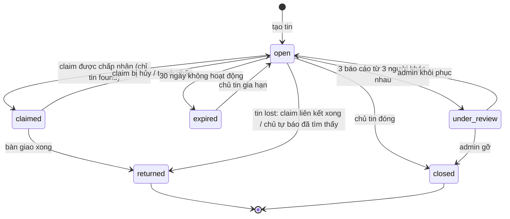
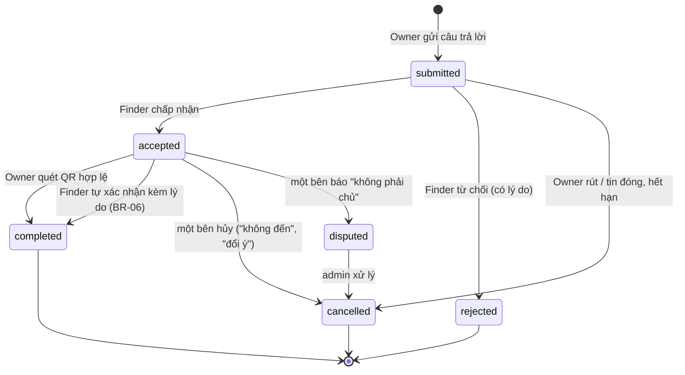

# 5. Máy trạng thái

Nguyên tắc:

- Bảng chuyển trạng thái là **hàm thuần** trong `domain`: `ItemStateMachine.next(state, action, ctx)` và `ClaimStateMachine.next(...)`. Hàm trả về trạng thái mới hoặc ném `InvalidTransitionException` (API trả `409 INVALID_STATE`). Test JUnit phủ mọi dòng của bảng và vài cặp không hợp lệ.
- Service gọi hàm thuần, rồi ghi DB **trong một transaction**, dùng `UPDATE ... WHERE id=? AND status=?` (khóa lạc quan theo trạng thái cũ). Cập nhật 0 dòng nghĩa là có người đổi trước → `409`. Không cần cột `version`.
- App không tự đổi trạng thái; app chỉ gọi hành động và hiển thị trạng thái server trả về.

So với mục 9 của tài liệu yêu cầu, có ba chỗ đơn giản hóa (lý do ở ADR-11 và `van-de-phat-hien.md`):

1. Bỏ `draft` khỏi server: bản nháp chỉ nằm trên máy (Zustand persist), server không lưu tin dở.
2. Bỏ `matched` khỏi trạng thái tin: một tin có thể khớp với nhiều tin, nên "khớp" là quan hệ (`match_candidates`), không phải trạng thái.
3. Gộp `handover_pending` vào `accepted`: mã QR là bản ghi có hạn trong `handovers`, không phải trạng thái; mã hết hạn thì tạo mã mới, không cần chuyển trạng thái ngược.

## 5.1 Tin (Item)

| #   | Từ                                      | Hành động          | Ai                            | Điều kiện                                                                                                                            | Sang                   | Tác dụng phụ (cùng transaction)                                                                    |
| --- | --------------------------------------- | ------------------ | ----------------------------- | ------------------------------------------------------------------------------------------------------------------------------------ | ---------------------- | -------------------------------------------------------------------------------------------------- |
| I1  | (mới)                                   | `create`           | Người đăng nhập               | BR-09: < 10 tin trong 24h; không nghi trùng hoặc `force=true`; `found` có ≥ 1 ảnh và câu hỏi kín; `lost` danh mục nhạy cảm thì 0 ảnh | `open`                 | `embedding_status=pending`; sau commit đánh thức job                                               |
| I2  | `open`                                  | `edit`             | Tác giả                       | Không có claim `accepted`                                                                                                            | `open`                 | Nếu đổi mô tả/ảnh/danh mục: `embedding_status=pending`, xóa embedding cũ; `last_activity_at=now()` |
| I3  | `open`                                  | `claim_accepted`   | Hệ thống (từ C2)              | Tin `found`                                                                                                                          | `claimed`              | —                                                                                                  |
| I4  | `claimed`                               | `claim_released`   | Hệ thống (từ C4, C5, C7, C10) | —                                                                                                                                    | `open`                 | —                                                                                                  |
| I5  | `claimed`                               | `handover_done`    | Hệ thống (từ C6, C6b)         | —                                                                                                                                    | `returned`             | Tin `lost` liên kết với claim (nếu có, đang `open`) cũng → `returned`                              |
| I6  | `open`                                  | `mark_found`       | Tác giả tin `lost`            | —                                                                                                                                    | `returned`             | Đóng các `match_candidates` của tin                                                                |
| I7  | `open`                                  | `close`            | Tác giả                       | Không có claim `accepted`; lý do ngắn                                                                                                | `closed`               | Các claim `submitted` → `rejected` (lý do "tin đã đóng")                                           |
| I8  | `open`                                  | `expire`           | Hệ thống (job theo giờ)       | `last_activity_at < now() - 30 ngày`                                                                                                 | `expired`              | Thông báo; các claim `submitted` → `cancelled`                                                     |
| I8a | `open`                                  | `warn_expiry`      | Hệ thống                      | Còn ≤ 3 ngày, chưa báo                                                                                                               | `open`                 | Thông báo "sắp hết hạn" (một lần)                                                                  |
| I9  | `expired`                               | `renew`            | Tác giả                       | —                                                                                                                                    | `open`                 | `last_activity_at=now()`                                                                           |
| I10 | `open`                                  | `report_threshold` | Hệ thống (từ báo cáo)         | Đủ 3 báo cáo `open` từ 3 người khác nhau, không phải tác giả                                                                         | `under_review`         | Ẩn khỏi danh sách, tìm kiếm, đối chiếu; báo admin                                                  |
| I11 | `under_review`                          | `restore`          | Admin                         | —                                                                                                                                    | `open`                 | Báo cáo → `invalid`                                                                                |
| I12 | `under_review`                          | `remove`           | Admin                         | —                                                                                                                                    | `closed`               | Báo cáo → `valid`; tác giả −10 uy tín; claim `submitted` → `rejected`                              |
| I13 | `open`, `closed`, `expired`, `returned` | `delete`           | Tác giả                       | Không có claim `accepted`                                                                                                            | (xóa mềm `deleted_at`) | Ẩn mọi nơi; giữ bản ghi cho claim/handover lịch sử                                                 |

"Hoạt động" cập nhật `last_activity_at`: tạo, sửa, gia hạn, có claim mới, có tin nhắn trong claim của tin.

Báo cáo trên tin đang `claimed` vẫn được ghi; admin thấy trong hàng chờ, nhưng tin không tự chuyển `under_review` để không cắt ngang một bàn giao đang diễn ra.

## 5.2 Yêu cầu nhận (Claim)

Claim chỉ tạo trên tin `found`. `lost_item_id` tùy chọn: điền khi claim bắt đầu từ một match hoặc từ báo khớp của Finder (FR-MATCH-06).

| #   | Từ                       | Hành động         | Ai                                     | Điều kiện                                                                                                                                                                                                                                                      | Sang                        | Tác dụng phụ (cùng transaction)                                                                                                                                   |
| --- | ------------------------ | ----------------- | -------------------------------------- | -------------------------------------------------------------------------------------------------------------------------------------------------------------------------------------------------------------------------------------------------------------- | --------------------------- | ----------------------------------------------------------------------------------------------------------------------------------------------------------------- |
| C1  | (mới)                    | `submit`          | Người đăng nhập, **không** phải Finder | Tin `found`, `open`, không `under_review`; chưa có claim `submitted`/`accepted` của mình trên tin này (unique index); số lần bị từ chối < giới hạn BR-05; nếu có `lost_item_id` thì người gửi phải là tác giả tin lost đó; hai người không chặn nhau (03 §3.5) | `submitted`                 | Lưu `answer`; thông báo Finder; `last_activity_at` của tin                                                                                                        |
| C2  | `submitted`              | `accept`          | Finder                                 | Tin đang `open` (chưa có claim `accepted` khác, unique index)                                                                                                                                                                                                  | `accepted`                  | Item I3 → `claimed`; tạo hàng `handovers` rỗng; thông báo Owner. Chat mở từ đây                                                                                   |
| C3  | `submitted`              | `reject`          | Finder                                 | Lý do 5–200 ký tự                                                                                                                                                                                                                                              | `rejected`                  | Thông báo Owner; lần thử được đếm cho BR-05                                                                                                                       |
| C4  | `submitted`              | `withdraw`        | Owner                                  | —                                                                                                                                                                                                                                                              | `cancelled`                 | Thông báo Finder                                                                                                                                                  |
| C4b | `submitted`              | `auto_cancel`     | Hệ thống                               | Tin bị đóng/hết hạn/gỡ (I7, I8, I12)                                                                                                                                                                                                                           | `cancelled` hoặc `rejected` | Thông báo Owner                                                                                                                                                   |
| C5  | `accepted`               | `cancel`          | Owner hoặc Finder                      | Lý do chọn sẵn: "không đến", "đổi ý", "khác"; tùy chọn đánh dấu vi phạm                                                                                                                                                                                        | `cancelled`                 | Item I4 → `open`; hủy mã QR; nếu đánh dấu vi phạm thì tạo `reports` cho admin                                                                                     |
| C5b | `accepted`               | `generate_code`   | Finder                                 | —                                                                                                                                                                                                                                                              | `accepted`                  | Ghi `code_hash`, `code_expires_at = now()+10 phút` vào `handovers` (mã cũ mất hiệu lực)                                                                           |
| C6  | `accepted`               | `scan_qr`         | Owner (claimant)                       | `sha256(code) = code_hash`, `now() < code_expires_at`, mã chưa dùng                                                                                                                                                                                            | `completed`                 | `handovers.method='qr'`, `completed_at`; Item I5; Finder +10 uy tín; các claim `submitted` khác của tin → `rejected` ("đã trả cho người khác"); thông báo hai bên |
| C6b | `accepted`               | `manual_complete` | Finder                                 | Lý do 10–200 ký tự                                                                                                                                                                                                                                             | `completed`                 | Như C6 nhưng `method='manual'` và **không** cộng uy tín (chống tự cày điểm, xem `van-de-phat-hien.md`)                                                            |
| C7  | `accepted`               | `dispute`         | Owner hoặc Finder                      | Lý do                                                                                                                                                                                                                                                          | `disputed`                  | Item I4 → `open`; tạo `reports` loại `claim` cho admin; chat khóa ghi                                                                                             |
| C8  | `disputed`               | `resolve`         | Admin                                  | Chọn bên vi phạm (hoặc không ai)                                                                                                                                                                                                                               | `cancelled`                 | Bên vi phạm −10 uy tín                                                                                                                                            |
| C9  | `submitted` / `accepted` | `expire`          | Hệ thống (job theo giờ)                | 7 ngày không có hành động                                                                                                                                                                                                                                      | `cancelled`                 | Item I4 nếu đang `accepted`; thông báo hai bên                                                                                                                    |
| C10 | `submitted` / `accepted` | `block`           | Hệ thống (từ `POST /users/{id}/block`) | Một bên chặn bên kia (R03, BR-15)                                                                                                                                                                                                                              | `cancelled`                 | Item I4 nếu đang `accepted`; hủy mã QR; thông báo bên bị chặn "Yêu cầu đã bị hủy", không nêu lý do                                                                |

## 5.3 Giới hạn thử (BR-05)

`AttemptPolicy.maxAttempts(reputation)` là hàm thuần:

| Uy tín | Số lần bị từ chối tối đa trên một tin |
| ------ | ------------------------------------- |
| < 0    | 1                                     |
| 0–29   | 3                                     |
| ≥ 30   | 5                                     |

Đếm = số claim `rejected` của người đó trên tin đó. Rút (`withdraw`) không bị đếm.

## 5.4 Nơi thực thi

| Việc                                          | Nơi                                                                                                                |
| --------------------------------------------- | ------------------------------------------------------------------------------------------------------------------ |
| Hợp lệ của chuyển trạng thái                  | `domain/*StateMachine` (hàm thuần)                                                                                 |
| Ai được làm hành động                         | `domain/*Access` (hàm thuần), gọi ở đầu mỗi method service                                                         |
| Ghi DB + tác dụng phụ                         | `application/*Service`, `@Transactional`, `UPDATE ... WHERE status = :old`                                         |
| Bất biến không thể vi phạm kể cả khi code sai | Ràng buộc DB: `CHECK (status IN ...)`, partial unique index "mỗi người 1 claim mở/tin", "mỗi tin 1 claim accepted" |
| Thông báo, push, WS                           | `@TransactionalEventListener(phase = AFTER_COMMIT)`, không gửi gì nếu transaction rollback                         |
| Hết hạn (I8, I8a, C9)                         | `@Scheduled` mỗi giờ + chạy một lần khi khởi động (vì server ngủ); GitHub Actions đánh thức server 1 lần/ngày      |
