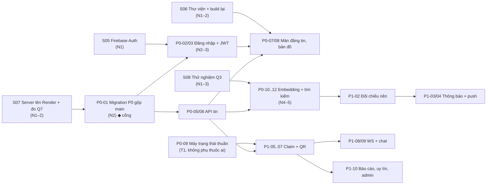

# 10. Kế hoạch 3 tuần

Nhóm **không chia việc cố định theo người** (ADR-12). Danh sách việc chi tiết, trạng thái và ai đang làm gì nằm ở [`docs/tien-do.md`](../tien-do.md). File này chỉ giữ thứ tự, phụ thuộc và điểm cắt.

## 10.1 Nguyên tắc nhận việc để ít đụng file nhau

- Mỗi việc trong `tien-do.md` có cột "File chính". Trước khi nhận, kiểm tra không có việc **Đang làm** nào sửa cùng file.
- Nên nhận việc theo **lát dọc** (cùng một module ở cả app `src/features/<x>` và server `com.refound.<x>`): ít phải sửa file của việc khác, và người làm tự giải thích được từ màn hình tới SQL khi bảo vệ.
- File dùng chung, chỉ sửa trong việc có ghi rõ, PR nhỏ và báo cả nhóm:

| File dùng chung                 | Quy tắc                                                                                                                         |
| ------------------------------- | ------------------------------------------------------------------------------------------------------------------------------- |
| Migration Flyway                | Mỗi việc tạo file riêng, tên theo giờ `V<yyyyMMddHHmm>__<module>_<mô tả>.sql` (ADR-13); một người khác đọc kỹ SQL trước khi gộp |
| `src/types/api.d.ts`            | Sinh tự động từ OpenAPI, không sửa tay; xung đột thì sinh lại                                                                   |
| `package.json`, `app.config.ts` | Chỉ thêm gói trong việc S06 (một đợt); thêm sau đó phải hỏi nhóm vì cả nhóm phải build lại                                      |
| `SecurityConfig`                | URL mới mặc định `authenticated`; đổi danh sách `permitAll` phải nêu trong PR                                                   |
| `pom.xml`                       | Báo nhóm khi thêm dependency                                                                                                    |

## 10.2 Phụ thuộc

N = ngày, T = tuần. Việc không có mũi tên vào có thể bắt đầu ngay ngày 1.

## 10.3 Lịch

| Tuần                   | Mục tiêu                                                                                                                                                                         | Mốc cuối tuần (Thứ Sáu)                                                                                                                                               |
| ---------------------- | -------------------------------------------------------------------------------------------------------------------------------------------------------------------------------- | --------------------------------------------------------------------------------------------------------------------------------------------------------------------- |
| **1: P0**              | N1–2: các việc S (chuẩn bị, đo đạc Q3/Q7/U13/U16), migration P0. Song song: máy trạng thái thuần + test, chụp ảnh bộ mẫu. N3–5: đăng nhập, đăng tin, danh sách, bản đồ, tìm kiếm | Đăng nhập (Google và SĐT thử) → đăng tin có ảnh → thấy trên bản đồ → tìm bằng chữ ra đúng món, trên máy thật, qua server Render. Có số top-5 đầu tiên. Q3, Q7 đã chốt |
| **2: P1**              | Đối chiếu nền + push, claim + QR, chat, thông báo trong app, báo cáo + uy tín, ảnh nhạy cảm, báo khớp chủ động, chống trùng, hết hạn                                             | Chạy trọn kịch bản demo 9.3 trên 2 máy; mọi test X1–X23 xanh                                                                                                          |
| **3: P2 + hoàn thiện** | N1–2: P2 nếu qua điểm cắt. N3–4: chỉnh trọng số, sửa lỗi, rà quyền theo ma trận, APK. N5: tập demo 2 lần, báo cáo                                                                | APK cuối; báo cáo; số top-5 cuối                                                                                                                                      |

Chiều Thứ Sáu mỗi tuần: demo nội bộ trên máy thật, cập nhật mục "Tình hình hiện tại" trong `tien-do.md`.

## 10.4 Điểm cắt P2

**Thứ Hai tuần 3, 12:00:** nếu kịch bản demo 9.3 chưa chạy trọn trên 2 máy, **bỏ toàn bộ P2**, dồn người vào sửa P1.

Nếu qua điểm cắt, làm theo thứ tự, mỗi mục ≤ 2 ngày-người:

| Thứ tự | Mục                     | Lý do                                                                                                        |
| ------ | ----------------------- | ------------------------------------------------------------------------------------------------------------ |
| 1      | FR-HEAT-01 bản đồ nhiệt | Rẻ nhất: một truy vấn gom ô + lớp heatmap của MapLibre, không thư viện mới                                   |
| 2      | FR-TAG-01 nhãn QR       | Dùng lại máy quét QR và chat có sẵn; cần bảng `tags` + luồng nhắn ẩn danh                                    |
| —      | FR-TAG-02 NFC           | **Đã cắt** (22/11/2026): cần thư viện native mới (`react-native-nfc-manager`), cả nhóm build lại ở tuần cuối |
| —      | FR-GEO-01 geofence      | **Đã cắt** (22/11/2026): vị trí nền + task nền, không ổn định giữa các hãng (R4), khó demo trong lớp         |

Hạ ưu tiên trong P1 nếu tuần 2 trễ (cắt từ trên xuống): FR-AUTH-04 xóa tài khoản → chỉ đăng xuất; FR-NOTI-03 bật/tắt từng loại → một công tắc chung; C8 admin xử lý tranh chấp → admin chỉ khóa tài khoản; NFR-08 offline → bỏ persist cache.
